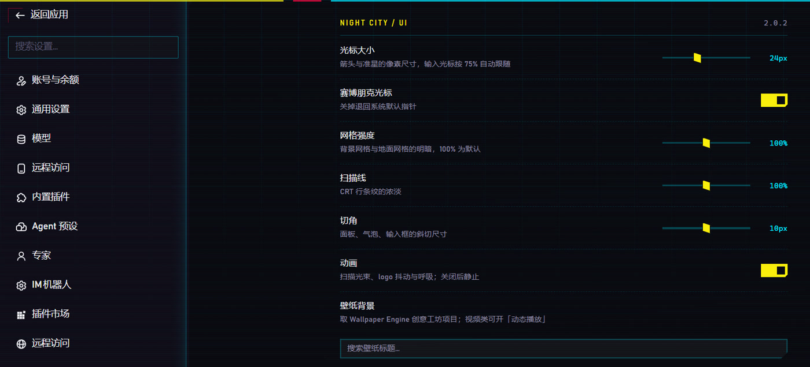
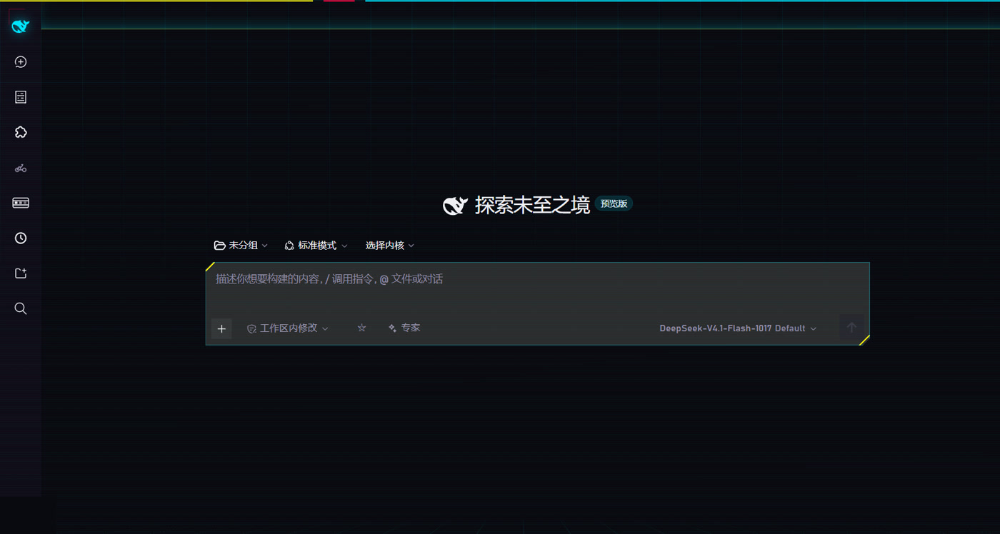
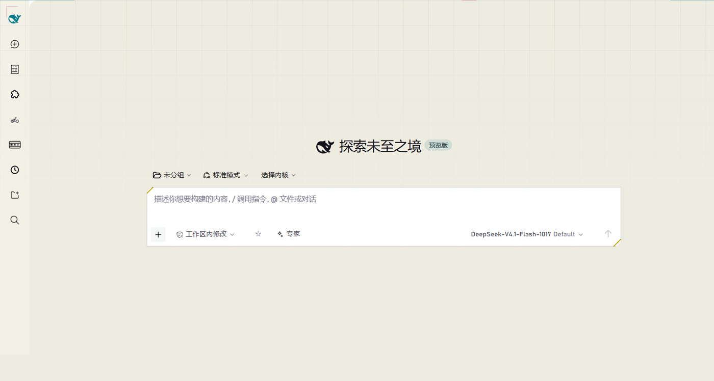
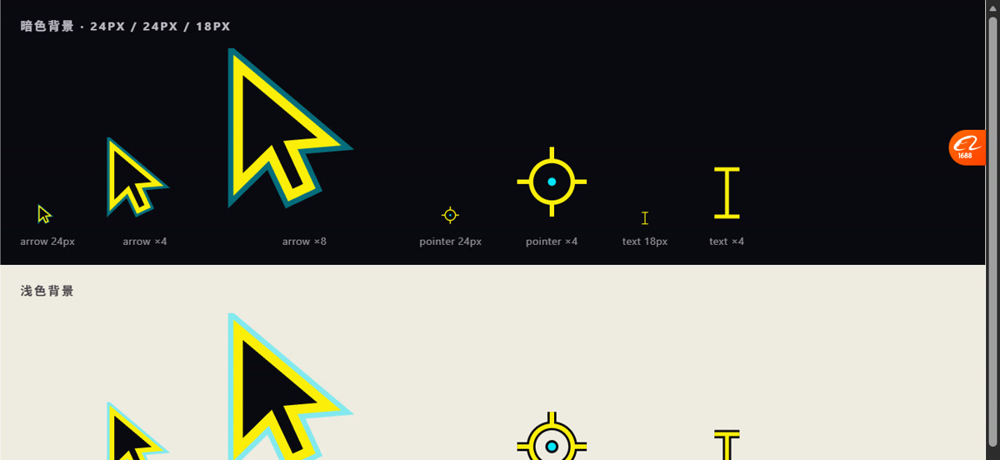

# Cyberpunk 2077 theme for DeepSeek Harness

[](https://github.com/lh15626127422-cloud/dsh-cp2077-theme/actions/workflows/ci.yml)
[](LICENSE)
[](https://github.com/lh15626127422-cloud/dsh-cp2077-theme/releases)

A Night City reskin for the DeepSeek Harness web GUI: near-black purple surfaces, Cyberpunk 2077 yellow
(`#FCEE0A`), neon cyan (`#00E5FF`) and magenta accents, chamfered HUD panels, a receding grid, CRT scanlines,
corner bracketed frames, glitch-typed wordmark, and cyberpunk cursors.

**[中文说明 → README.md](README.md)**

---



| Dark · wallpaper on | Light | Cursors & menu |
| --- | --- | --- |
|  |  |  |

## What you get

- **Palette** — whole DSH token set overridden (surfaces, text, borders, code highlighting, scrollbars, focus ring),
  with a separate light-mode calibration so it does not look like a washed-out dark theme.
- **Panel language** — chamfered composer card with yellow bevel highlights, chamfered primary buttons, keycap
  chips flattened into mono text, opaque popover menus, HUD rulers and corner brackets.
- **Motion** — a slow scanline sweep, a thin travelling beam, a breathing logo with an SVG-displacement glitch
  (band tearing, not a wrapper translate), and one master switch to turn all of it off.
- **Cursors** — three inline-SVG cursors (arrow, ring pointer, bracket I-beam) that scale with a size slider.
- **Wallpaper mode** — pulls covers from your Wallpaper Engine workshop library, with static covers, a still frame
  extracted from the source video, or an animated WebP clip. A settings panel controls opacity, grid strength,
  chamfer size, cursor size and cache budget.
- **Settings panel** — DSH *Settings → Cyberpunk theme*: every knob applies live, no reload.

## Requirements

- DeepSeek Harness `0.2.x` with the web GUI (uses the `webServer` host service plus the `theme` and `slots` client services).
- Node.js 20+ to run the installer and the tests.
- Optional: **ffmpeg** on `PATH` — only needed for video wallpapers (still extraction and animated WebP loops).
- Optional: **Wallpaper Engine** — without it the theme works fine, the wallpaper picker is just empty.

## Install

```bash
git clone https://github.com/lh15626127422-cloud/dsh-cp2077-theme.git
node dsh-cp2077-theme/scripts/install.mjs
```

The installer symlinks the checkout into `~/.dsh/profiles/web/node_modules/@local/cp2077-theme`
(pass a different profile directory as the first argument if yours differs). Then add one line to
`~/.dsh/profiles/web/package.json`:

```json
{
  "dependencies": {
    "@local/cp2077-theme": "link:/absolute/path/to/dsh-cp2077-theme"
  }
}
```

Restart DeepSeek Harness and refresh the page. Editing files in the checkout takes effect on the next reload.

Alternative manual install: create the symlink yourself and add the same `dependencies` entry.

## Configuration

Only the wallpaper library location may need configuring; everything else lives in the panel. The plugin
detects Steam automatically (Windows: `HKCU\Software\Valve\Steam` registry value, then every library listed in
`libraryfolders.vdf`; macOS and Linux: the usual Steam directories). Resolution order:

1. plugin config `workshopRoot`
2. environment variable `CP2077_WORKSHOP_ROOT`
3. automatic detection
4. platform fallbacks

Set it explicitly in `cordis.patch.yml` when needed:

```yaml
- insert:
    - id: cp2077-theme
      name: '@local/cp2077-theme'
      config:
        workshopRoot: 'D:/Steam/steamapps/workshop/content/431960'
```

The panel reports where the path came from (`detected` / `config` / `env` / `fallback`) and shows the full path
when it was not auto-detected, so an empty picker is diagnosable rather than silent.

## Limitations

- Styling targets DSH's internal class-name suffixes (`centerCol`, `sessionRow`, `data-menu-material`,
  `data-slot`, `data-composer-input`, …). Data attributes are preferred over hashed class names, but a DSH
  redesign can still orphan a rule — the symptom is a piece of styling silently not applying; nothing throws.
- Video wallpapers are served as extracted stills or animated WebP clips, because the embedded WebView used by
  the desktop app does not composite `<video>` layers.
- Wallpaper Engine `scene` projects are encrypted packages; only their `preview` cover can be shown.

## Tests

```bash
node test/harness-test.mjs      # crash harness: disposal, hostile contexts, idempotent self-heal
node test/wallpaper-route.mjs   # HTTP routes: scan, traversal guard, byte serving, cache budget
```

Both suites run on Linux CI without a Wallpaper Engine install; cover-dependent assertions self-skip.

## Changelog

Version history lives in the [Chinese README](README.md#更新日志) and in
[releases](https://github.com/lh15626127422-cloud/dsh-cp2077-theme/releases).

## License

MIT